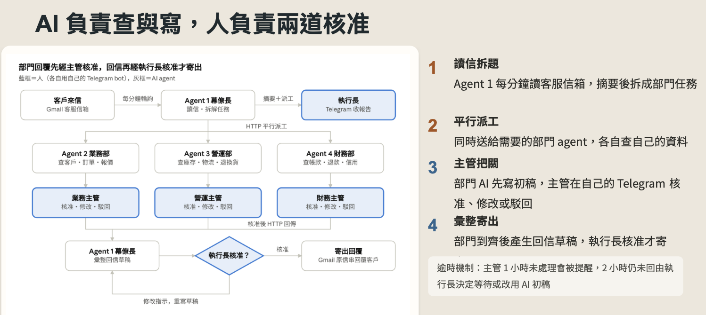
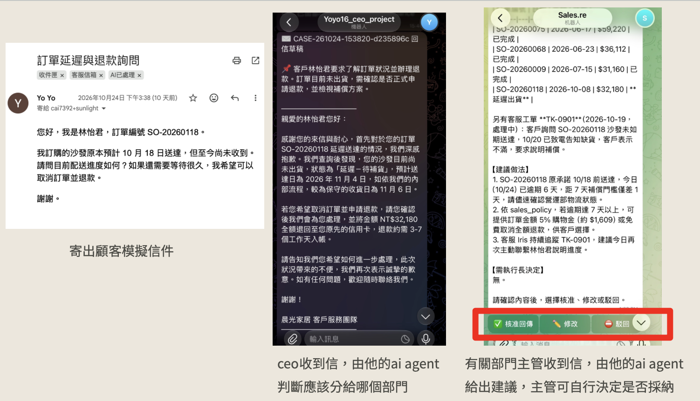

# 🤖 Multi-Agent HITL Support System 
[**English**](./README.md) | [繁體中文](./README.zh-TW.md)

> **An enterprise-grade, cross-department AI customer service system built on Multi-Agent architecture and strict Human-in-the-Loop (HITL) mechanisms.**


## Background & Core Concept (Why build this?)
In real-world enterprise scenarios, handling a single customer complaint is often extremely tedious, requiring cross-departmental data retrieval from Sales, Operations (Logistics), and Finance. Relying solely on a single LLM easily leads to risks such as "hallucination," "unauthorized commitments," or "confidential data leaks."

To solve this pain point, this project established a virtual enterprise named "SunLight Home" to test a **Multi-Agent Architecture** combined with a strict **Human-in-the-Loop (Double Approval) Mechanism**. AI handles the tedious cross-departmental "data verification" and "draft writing," while human managers focus on "decision-making" and "approval," achieving an enterprise-grade AI application that balances efficiency and safety.

## System Architecture
The system divides the virtual enterprise into four nodes, where 4 Agents assist 4 human managers in collaboration:
* **Agent 1 (CEO's Chief of Staff)**: Polls the Gmail inbox, identifies customer intents, breaks down tasks, performs parallel dispatching to departments, and consolidates the final reports.
* **Agent 2, 3, 4 (Sales / Ops / Finance)**: Uses RAG technology to read isolated Google Sheet databases for each department and generates professional draft responses.

*(The diagram below shows how the system automatically distributes tasks upon receiving an email, and sends the reply after passing two human approval checkpoints)*



## Key Features

### 1. Strict Human-in-the-Loop (Double Human Approval)
This system deeply integrates the Telegram API, embedding decision-making into the managers' daily communication app:
* **1st Defense Line (Department Approval)**: After the department Agent generates a draft, the department manager must click `✅ Approve`, `✏️ Edit`, or `⛔ Reject` in Telegram.
* **2nd Defense Line (CEO Decision)**: Once approved contents are consolidated into a final draft, the CEO must give final approval in Telegram before the system calls the Gmail API to send it, completely eliminating the risk of rogue AI.

*(Live Demo: From customer email > CEO Chief of Staff dispatch > Department AI data retrieval & manager approval)*



### 2. Cross-Department Data Privacy & Segregation
Breaking the dangerous practice of "feeding all enterprise data into a single AI," the system follows the principle of least privilege:
* **Sales Dept** only accesses customer tiers and pricing (`dept_sales.xlsx`).
* **Ops Dept** only accesses multi-warehouse inventory and logistics (`dept_ops.xlsx`).
* **Finance Dept** only accesses confidential costs, margins, and overdue accounts (`dept_finance.xlsx`).
Each Agent communicates securely via independent HTTP requests with a Shared Secret.

### 3. Escalation Mechanism
If a department manager fails to review within 1 hour, the system sends an automatic reminder. After 2 hours, the decision-making authority escalates to the CEO, who decides whether to "continue waiting" or "reply urgently using the AI draft (marked as unreviewed)."

---

## Quick Start

This system is serverless, with core logic deployed on Google Apps Script (GAS).

### 1. Prepare Mock Database
The project includes a Python script to generate interrelated department databases (containing test scenarios like delayed shipping, bulk quoting, duplicate charges, etc.):

```bash
# Install dependencies
pip install pandas openpyxl

# Run generation script
python generate_mock_data.py
```
*(Upload the generated `dept_sales.xlsx`, `dept_ops.xlsx`, and `dept_finance.xlsx` to Google Drive and convert them to Google Sheets).*

### 2. Deploy Apps Script
1. Deploy `agent1_ceo_bot.gs` as the Web App for Agent 1.
2. Deploy `dept_agent.gs` individually for the three department managers.
3. Configure the corresponding API Keys (OpenAI, Anthropic), Telegram Bot Tokens, and Web App URLs in the "Script Properties" of GAS to link all nodes.

## Documentation
Our team has written comprehensive implementation guides and design manuals. Please refer to:
* 🔗 [AI Virtual Enterprise Proposal Presentation (PDF)](docs/AI虛擬企業簡報.pdf)
* 🔗 [AI Agent Enterprise Team: Architecture Design Manual (PDF)](docs/AI_Agent_企業團隊：部門設計與建置手冊.pdf)
* 🔗 [Department Agent Setup Guide (SOP) (PDF)](docs/部門_Agent_建置手冊（給部門主管）.pdf)
