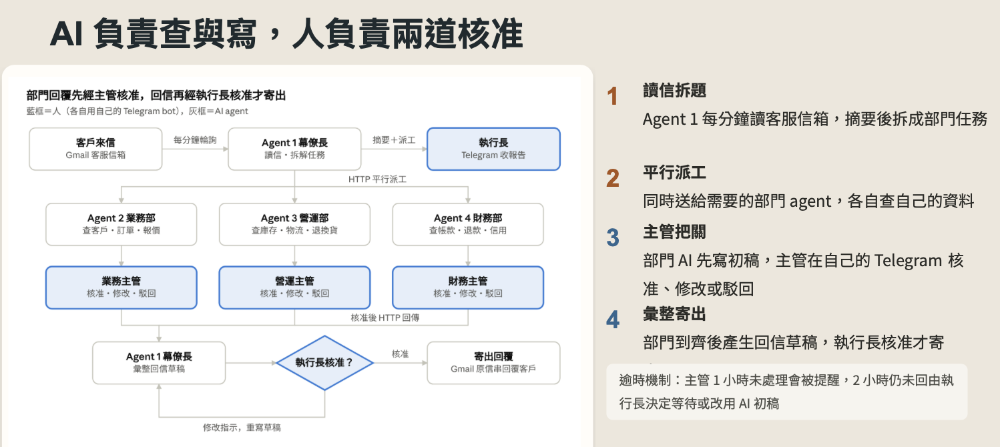
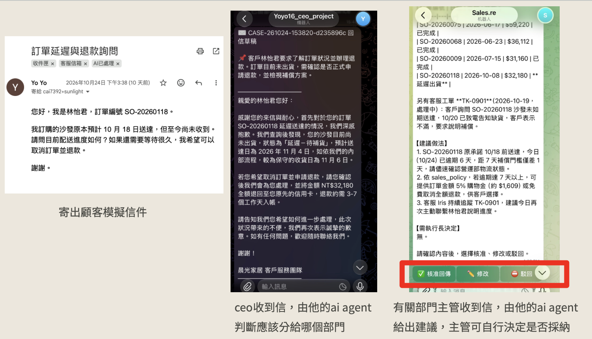

# 企業級多智能體跨部門協作系統
[English](./README.md) | [**繁體中文**](./README.zh-TW.md)
> **基於多智能體 (Multi-Agent) 與 Human-in-the-Loop 打造的企業級跨部門 AI 客服協作系統**


##  專案背景與核心理念 (Why build this?)
在真實企業場景中，處理一封客訴信件往往極度繁瑣，需要跨越業務、營運 (物流)、財務等多個部門調閱資料。若單純依賴單一 LLM，極易產生「幻覺 (Hallucination)」、「越權承諾」或「機密外洩」的風險。

為了解決此痛點，本專案建立了一個名為「晨光家居 (SunLight Home)」的虛擬企業，並導入 **Multi-Agent 架構** 與嚴格的 **Human-in-the-Loop (雙重人工把關) 機制**。讓 AI 負責繁瑣的跨部門「資料查證」與「草稿撰寫」，而人類主管專注於「決策」與「核准」，實現兼顧效率與安全的企業級 AI 應用。

## 系統架構 (System Architecture)
本系統將虛擬企業分為四個節點，由 4 個 Agent 協助 4 位真人主管進行協作：
* **Agent 1 (執行長幕僚長)**：負責輪詢 Gmail 收件匣、識別客戶意圖、拆解任務並行派工 (Parallel Dispatching)，最後彙整各部門回報。
* **Agent 2, 3, 4 (業務/營運/財務部)**：透過 RAG 技術讀取各部門獨立的 Google Sheet 資料庫，生成專業回覆初稿。

*(下圖展示了客戶來信後，系統如何自動分工，並通過兩道人工關卡核准後寄出回信)*



## 核心特色 (Key Features)

### 1. 嚴格的 Human-in-the-Loop (人機協作雙重把關)
本系統深度整合 Telegram API，讓決策融入主管的日常通訊軟體中：
* **第一道防線 (部門審核)**：部門 Agent 生成初稿後，部門主管需在 Telegram 點擊 `✅ 核准`、`✏️ 修改` 或 `⛔ 駁回`。
* **第二道防線 (CEO 決策)**：各部門審核通過的內容彙整成回信草稿後，CEO 需在 Telegram 最終核准，系統才會呼叫 Gmail API 寄出，徹底杜絕 AI 失控風險。

*(下圖為實機運作畫面：從客戶寄信 ➡️ CEO 幕僚長派工 ➡️ 部門 AI 調閱資料並請求主管核准)*



### 2. 跨部門資料權限隔離 (Data Privacy & Segregation)
打破「把所有企業資料餵給同一個 AI」的危險做法。系統遵循最小權限原則：
* 業務部只能存取客戶等級與報價 (`dept_sales.xlsx`)
* 營運部只能存取多倉儲庫存與物流 (`dept_ops.xlsx`)
* 財務部只能存取機密的成本毛利與逾期帳款 (`dept_finance.xlsx`)
各 Agent 透過獨立的 HTTP 請求與共用密碼 (Shared Secret) 進行安全通訊。

### 3. 異常與逾時自動升級機制 (Escalation Mechanism)
若部門主管超過 1 小時未審核，系統會自動發送提醒；超過 2 小時，系統會將決策權向上遞交給 CEO，由 CEO 決定是否要「繼續等待」或「採用 AI 初稿緊急回覆 (並標註未經審核)」。

---

## 快速啟動與測試 (Quick Start)

本系統為 Serverless 架構，核心邏輯佈署於 Google Apps Script (GAS)。

### 1. 準備虛擬企業資料庫 (Mock Data)
專案內附 Python 假資料生成腳本，可一鍵生成具備關聯性的部門資料庫 (內含延遲到貨、大量報價、重複扣款等測試情境)：

```bash
# 安裝依賴套件
pip install pandas openpyxl

# 執行生成腳本
python generate_mock_data.py
```
*(執行後將產生 `dept_sales.xlsx`, `dept_ops.xlsx`, `dept_finance.xlsx`，請上傳至 Google Drive 轉為試算表)*

### 2. 佈署 Apps Script
1. 將 `agent1_ceo_bot.gs` 佈署為 Agent 1 的 Web App。
2. 將 `dept_agent.gs` 分別佈署給三位部門主管。
3. 於 GAS 的「指令碼屬性」中填入對應的 API Keys (OpenAI, Anthropic)、Telegram Bot Tokens 及 Web App URLs，進行各節點串聯。

## 專案文件與手冊 (Documentation)
本團隊為此系統撰寫了完整的企業導入指南與設計手冊，歡迎參閱：
* 🔗 [AI 虛擬企業完整提案簡報](docs/AI虛擬企業簡報.pdf)
* 🔗 [AI Agent 企業團隊：系統架構設計手冊](docs/AI_Agent_企業團隊：部門設計與建置手冊.pdf)
* 🔗 [部門 Agent 建置手冊 (SOP)](docs/部門_Agent_建置手冊（給部門主管）.pdf)
